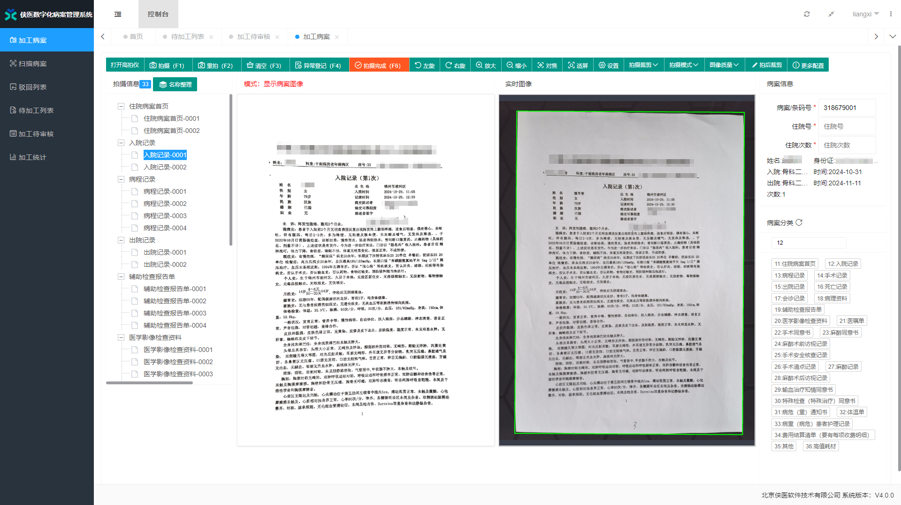
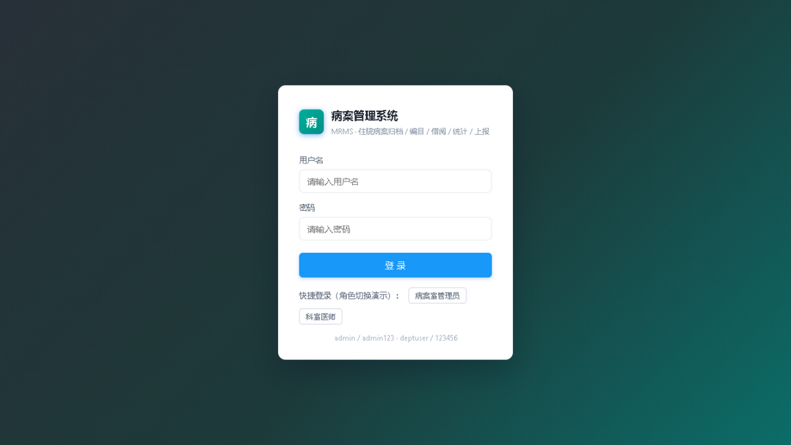
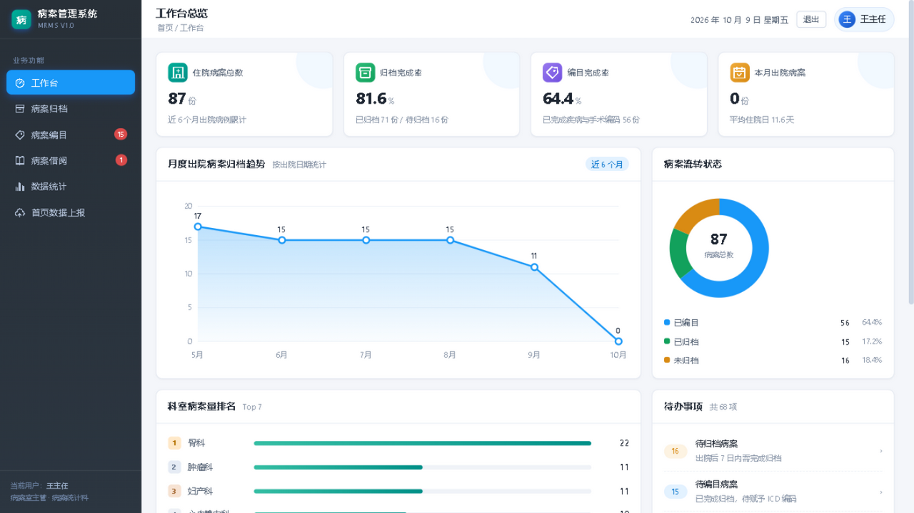
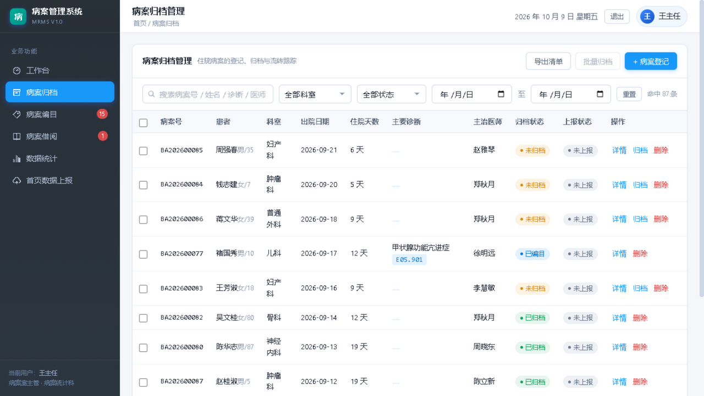
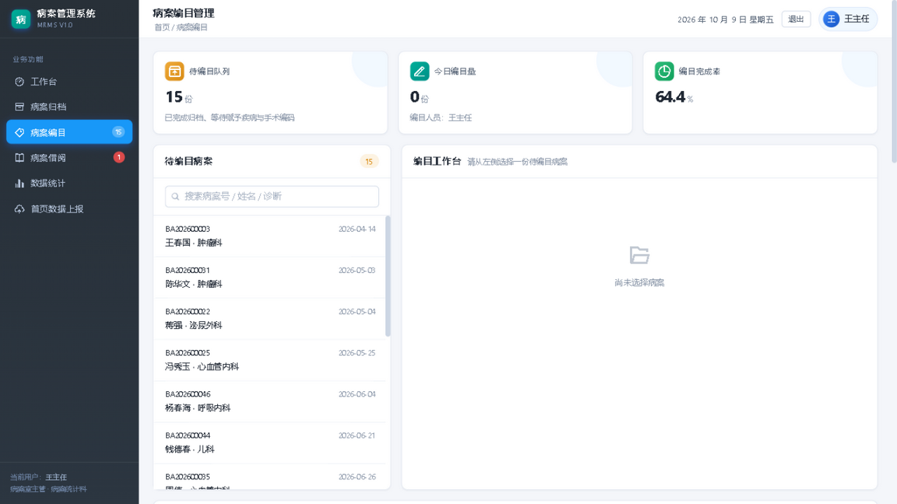
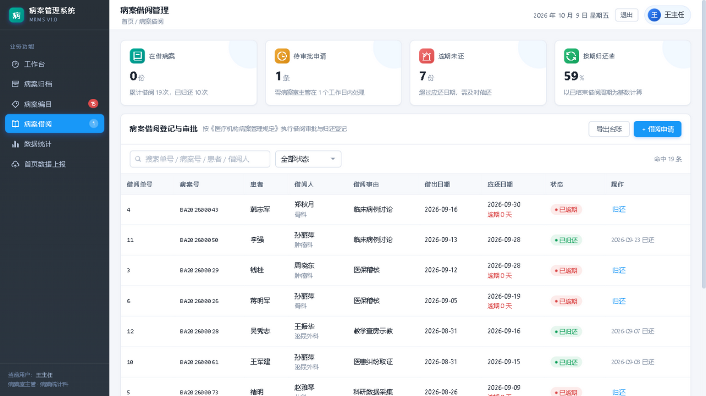
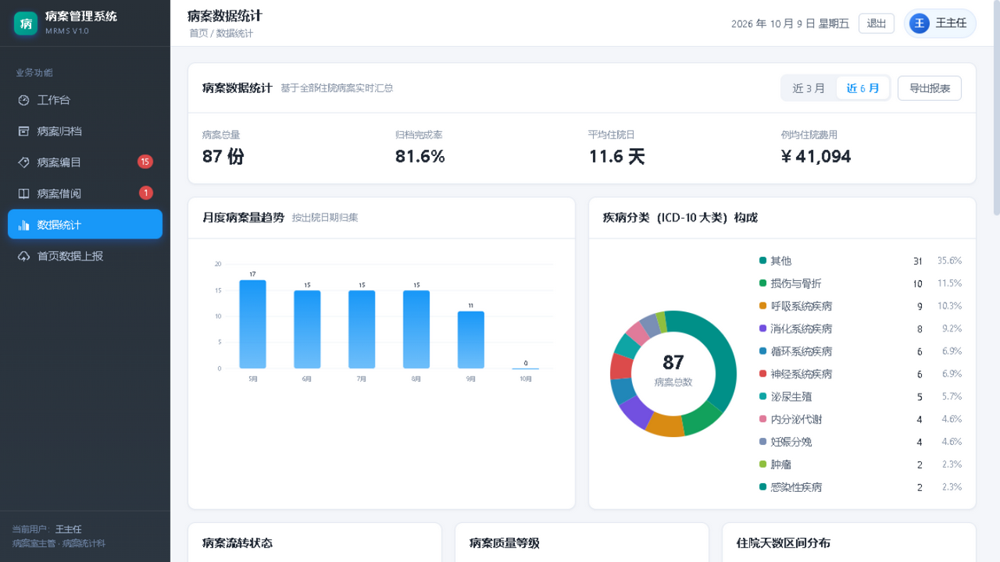
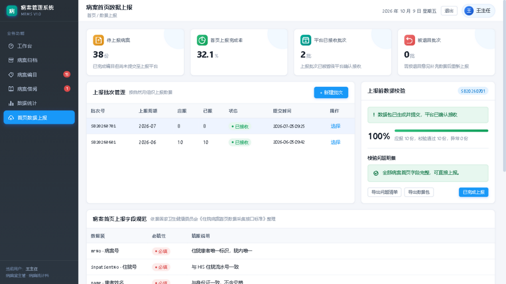
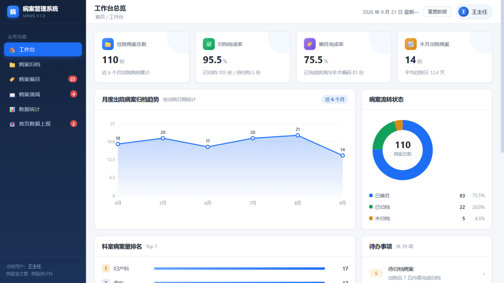
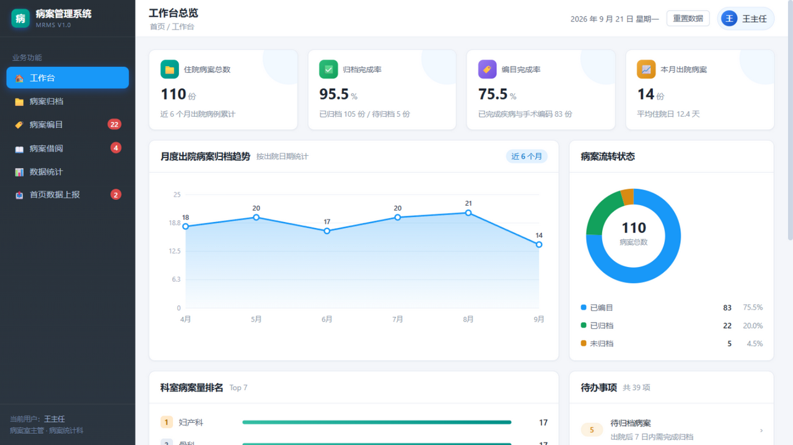

# 病案管理系统 · 系统规格说明书（SPEC）

> **文档定位**：答辩汇报用系统规格说明。面向评审与技术交接，重点呈现「参考了什么 → 设计成什么样 → 实现到什么程度 → 如何验证」。
> **交付形态**：WebUI 单页应用（浏览器访问）+ Go 后端服务 + PostgreSQL 数据库。
> **文档版本**：V1.1 ｜ 编制日期：2026-09-22 ｜ 最近更新：2026-10-09（收录「功能扩展批次 1」十项能力）
> 配套文档：`DESIGN.md`（架构设计）、`prototype/BASELINE.md`（原型基线）、`mrs-backend/docs/API.md`（接口契约）、`docs/extension-guide.html`（扩展功能操作指南）

---

## 参考源

> 编号 P = 项目内参考源，E = 外部参考源。核实状态：**[已核实]** = 直接抓取/读取源文件；**[检索核实]** = 联网检索返回摘要。

### 项目内参考源（P）

| 编号 | 名称 | 来源 | 核实 |
|---|---|---|---|
| P1 | 项目题目（需求方原文） | "9. 病案管理系统——管理住院病案的归档、编目、借阅和统计，支持病案首页数据的上报。" | 已核实 |
| P2 | 《病案管理系统调研工作规划（12 节标准版）》V1.0，2026-09-18 | 需求方交付 docx（12 节功能主题 + 5 阶段调研部署 + 4 条质量控制要求） | 已核实（解析全文） |
| P3 | 病案管理系统骨架设计 V2.1 | `DESIGN.md`（需求域、三条状态机、表结构、技术栈） | 已核实 |
| P4 | 项目说明 | `README.md`（启动方式、种子数据规模） | 已核实 |
| P5 | 原型基线冻结记录 | `prototype/BASELINE.md`（D1–D10 决策、全局不做清单） | 已核实 |
| P6 | 接口契约 | `mrs-backend/docs/API.md`（94 条路由、状态枚举、菜单对照） | 已核实 |
| P7 | 配色实测脚本 | `prototype/xiayi_palette.py`（像素采样 + 布局测量） | 已核实 |
| P8 | 参考实现实拍图 | `prototype/reference/xiayi-workstation.jpg`、`xiayi-print.jpg` | 已核实 |
| P9 | 配色对齐层 | `frontend/css/theme-xiayi.css`（实测色值落地） | 已核实 |
| P10 | 原型逐屏决策页 | `prototype/review.html`（六屏实拍 + 逐屏判定 + 决策点） | 已核实 |

### 外部参考源（E）

| 编号 | 名称 | 来源 | 类型 | 核实 |
|---|---|---|---|---|
| E1 | 侠医《数字化病案管理系统》（DMRMS） | https://www.ixiayi.net/dmrms.htm | 厂商产品（**视觉基准**） | 已核实（逐页抓取） |
| E2 | 今创科技 病案管理系统 / 首页质控 / DRG 预分组 | http://www.shcreating.com ；http://www.300290.com | 厂商产品（功能对标） | 检索核实 |
| E3 | 易通云科 病案示踪 / 智慧病案 | http://www.scbagl.com | 厂商产品（流转追溯对标） | 检索核实 |
| E4 | HQMS 国家医院质量监测系统 | http://www.hqms.org.cn | 标准/平台（上报机制） | 检索核实 |
| E5 | 《住院病案首页数据采集质量与接口标准（2020 年版）》 | 依据国卫办医政函〔2025〕14 号 | 标准（上报字段与一级质控） | 检索核实 |
| E6 | 《住院病案首页数据填写质量规范（暂行）》+《首页数据质量管理与控制指标（2016 版）》国卫办医发〔2016〕24 号 | https://www.nhc.gov.cn/wjw/c100175/201606/b41dfe1ef9f04156aa298d3e9b815d18.shtml | 规范（质控规则依据） | 检索核实 |
| E7 | 《医疗机构病历管理规定（2013 年版）》国卫医发〔2013〕31 号 | https://www.nhc.gov.cn/wjw/c100175/201312/0430f5400b4e482b9a4d766f16ce1b55.shtml | 法规（借阅/复印/封存） | 检索核实 |
| E8 | 《住院病案首页》（卫医政发〔2011〕84 号）及填写说明 | 2016 版规范的制定基础 | 规范（字段来源） | 检索核实 |
| E9 | 《电子病历应用管理规范（试行）》国卫办医发〔2017〕8 号 | 2017 年印发 | 规范（封存与审计） | 检索核实 |
| E10 | 专利 CN105844566A《一种电子病历归档管理系统及方法》（东华软件） | https://patents.google.com/patent/CN105844566A/zh | 专利（归档流程） | 检索核实 |

> **引用说明**：E4–E10 为检索返回摘要，关键条款定稿前建议抽验原文；E5 具体字段以官方正式发布文档为准（与调研文档质量控制第 2 条一致：**禁止以口头需求作为设计依据**）。

---

## 一、项目概述

### 1.1 题目与目标

> **管理住院病案的归档、编目、借阅和统计，支持病案首页数据的上报。**

系统覆盖住院病案从**出院回收**到**首页数据上报**的完整生命周期，为病案室提供归档作业、ICD 编码、借阅监管、统计分析与上报质控的一体化工具，并满足《医疗机构病历管理规定》对借阅留痕、封存冻结、操作审计的合规要求。

### 1.2 交付形态

| 层 | 形态 | 访问方式 |
|---|---|---|
| **界面** | **WebUI 单页应用**（Vue 3，零构建、零第三方依赖） | 浏览器访问，登录后进入 |
| 服务 | Go 单体服务（Gin + GORM） | HTTP API + 静态资源 |
| 数据 | PostgreSQL 16（主库）+ Redis（热点缓存，可降级） | — |
| 部署 | Docker Compose 三容器 / 本地免 Docker 双轨 | 一键启动 |

### 1.3 功能域一览

| # | 功能域 | 核心能力 | 对应调研节 |
|---|---|---|---|
| 1 | 登录与权限 | JWT 认证、角色分级（病案管理员 / 科室医师）、操作审计 | 节 2、10 |
| 2 | 病案归档 | 病案登记、批量回收、归档上架（架位容量校验）、封存、流转履历 | 节 3 |
| 3 | 病案编目 | 待编目队列、ICD-10/ICD-9-CM-3 选码、编码存在性校验、质量分级 | 节 4 |
| 4 | 病案借阅 | 申请 → 多级审批 → 借出 → 归还核销、续借、逾期催还、台账追溯 | 节 5、6 |
| 5 | 数据统计 | 状态分布、归档率、疾病谱、科室排名、费用与住院日分布 | 节 7 |
| 6 | 首页质控 | 五类规则校验（必填/条件必填/逻辑/编码存在性/主诊断选择）、逐字段异常标记、质量评分与甲乙丙等级、**退回-整改-复核闭环**、归档锁定与变更留痕 | 节 8 |
| 7 | 首页上报 | 批次管理、上报前校验、XML 组包、回执状态、失败排查、**接口标准 CSV 导出**、**上报一致性核对** | 节 9 |
| 8 | 基础数据 | 科室、医师、ICD 编码库（版本化）、架位、通用字典 | 节 11 |
| 9 | 合规安全 | 操作日志审计、数据权限范围、病案禁删、封存冻结、**归档后变更留痕** | 节 12 |
| 10 | **智能与决策辅助**（批次 1 新增） | **规则版预编码推荐**、**DRG/DIP 入组预检**、**归档及时率与超期催缴** | 节 4、7（延伸） |

---

## 二、功能设计

### 2.1 需求来源：从 12 节调研到 8 个功能域

需求来自**题目四域 + 调研文档 12 节**（P1/P2）。调研文档按「每节 3 分钟讲解」的课件颗粒度规划了 12 个主题，本系统将它们归并为 **8 个功能域 + 6 个界面模块**，菜单顺序与课件顺序一致（便于边开发边录课）：

| 调研节 | 主题 | 归入功能域 |
|---|---|---|
| 1 | 系统定位与业务价值 | 汇报开篇 |
| 2 | 系统基础操作 | 登录与权限 |
| 3 | 病案归档管理 | 归档 |
| 4 | 病案编目管理 | 编目 |
| 5 | 病案借阅申请与审批 | 借阅（申请审批） |
| 6 | 病案借阅台账管理 | 借阅（台账） |
| 7 | 病案统计分析 | 统计 |
| 8 | 病案首页数据质控 | 首页质控 |
| 9 | 病案首页上报操作 | 首页上报 |
| 10 | 用户与权限配置 | 登录与权限 / 基础数据 |
| 11 | 基础数据维护 | 基础数据 |
| 12 | 合规要求与常见问题 | 合规安全 |

### 2.2 核心设计：三条状态机

系统以**状态机**为骨架，所有业务动作都是对状态的受控流转，这既保证业务正确性（不可跳步、不可逆序），又天然形成审计轨迹。

#### 2.2.1 病案主状态机（全系统锚点）

```
        批量回收              首条编目            归档上架
未回收 ──────────→ 已回收 ──────────→ 已编目 ──────────→ 已归档(在架)
NOT_RECYCLED      RECYCLED          CATALOGED         ARCHIVED
                                                        │  ↑
                                            借出 ↓      │  │ 归还
                                                借出 BORROWED
                                                        │
                                              封存 ↓     │
                                                 封存 SEALED（终态）
```

| 取值 | 中文 | 进入条件 | 代码位置 |
|---|---|---|---|
| `NOT_RECYCLED` | 未回收 | 病案登记（初态） | — |
| `RECYCLED` | 已回收（待编目） | 批量回收 | `handler/archive.go` |
| `CATALOGED` | 已编目 | 首条编目录入 | `handler/catalog.go` |
| `ARCHIVED` | 已归档（在架） | 归档上架（绑定架位） | `handler/archive.go` |
| `BORROWED` | 借出 | 借出操作 | `handler/borrow.go` |
| `SEALED` | 封存 | 封存（仅从在架） | `handler/archive.go` |

**流转均采用条件更新**（`WHERE status = 期望前态`），并发下天然防重、防跳步。

#### 2.2.2 借阅子状态机

```
申请(可加急) → 审批中 ──逐级通过──→ 已批准 → 借出 → 归还核销
APPLYING               APPROVED   BORROWED   RETURNED
    │                                │
    └──任一级驳回→ 已驳回 REJECTED     └──超期→ 逾期 OVERDUE（定时任务标记+催还记录）
```

- **多级审批**：审批级数可配置（`config.yaml borrow.approve_levels`），逐级落库 `borrow_approval`，全部通过才置「已批准」，任一级驳回即终止。
- **逾期催还**：进程内定时任务每小时扫描，超应还日期的借出单自动置「逾期」并写催还记录（`borrow_reminder`）。
- **归还核销**：归还时病案状态同步回「在架」，形成借出-归还回环。
- **合规依据**：《医疗机构病历管理规定》第 16 条「借阅病历应当 3 个工作日内归还，不得带离本院」（E7）。

#### 2.2.3 首页质控与上报子状态机

```
草稿 → 待质控 → 质控通过（可上报） → 已上报（终态）
        │           ↑
        └→ 质控退回 ─┘ 修正后重新质控
   WAIT_QC   QC_REJECTED →（修正保存）→ WAIT_QC
```

**质控项处理闭环**（批次 1 新增，任务 5；状态落在 `front_page_qc_result.handle_status`）：

```
OPEN 待处理 ──病案室退回──→ RETURNED 已退回临床 ──临床整改──→ RECTIFIED 已整改待复核
                                                                  │
                                            复核 PASS → CLOSED 已闭环（终态）
                                            复核 FAIL → REJECTED_BY_QC ──→ 再整改
```
> 旁路：病案室也可直接 `PUT /qc-results/:id/fixed` 标记修正，跳过闭环直达 `CLOSED`。
> **临床端已补齐（D4，2026-10-09）**：新增「我的待整改」页（侧栏第 8 项），`deptuser` 登录后只看**本科室**待整改项，可逐条提交整改（`POST /qc-results/:id/rectify`）；`admin` 打开同一页显示**全院督办**视角。`rectify` 接口的权限已从「任意登录用户」收紧为 `DEPT_USER` + `ADMIN`（保留 ADMIN 是为了不破坏病案室在编目页的「模拟整改」演示入口），且对 `DEPT_USER` 追加**本科室归属校验**（数据范围 DEPT）。

- **质控五类规则**（对齐 2016 版规范与 2020 版接口标准的一级质控，E5/E6）：
  - `REQUIRED` 必填校验 — 患者姓名、入出院时间、主要诊断编码等
  - `REQUIRED` + `conditionExpr` **条件必填**（批次 1 新增）— 仅当条件成立才校验，如「主诊断为损伤中毒（`S/T` 编码）须填外部原因」「新生儿（`P` 编码）须填出生体重/孕周」「有住院天数则出院诊断必填」
  - `LOGIC` 逻辑校验 — 出院时间晚于入院时间、住院天数大于 0
  - `CODE_EXIST` 编码存在性 — 诊断编码须存在于 ICD-10 字典、手术编码须存在于 ICD-9-CM-3 字典
  - `DIAG_OP_MATCH` **主诊断-主手术匹配**（批次 1 新增）— 防落 DRG 歧义组（QY）导致医保 50% 折付，判定简表见 `service/drg_rules.go`
  - `MAIN_DIAG_RULE` **主要诊断选择合理性提示**（批次 1 新增）— 慢性病主诊断却实施手术、后遗症/恢复期类编码作主诊断时提示核对
- **规则可配置**：规则存 `qc_rule` 表（13 条种子规则），不硬编码，便于按院方规则清单扩展。条件表达式支持 `字段 LIKE '前缀%'` 与 `actual_days>0`、`has_operation` 等轻量写法，未识别表达式**保守按条件成立处理**（宁可多校验不漏校验）。
- **异常逐字段落库**：命中规则写入 `front_page_qc_result`（字段名 / 错误级别 / 描述 / 是否已修正），支持修正后重审闭环。
- **质量评分与分级**（批次 1 新增，任务 16）：每次质控按记录覆盖写 `front_page_quality`。基础 100 分，每条 `ERROR` −15、每条 `WARN` −5，最低 0 分；`≥90 甲级(A)`、`75–89 乙级(B)`、`<75 丙级(C)`；**单项否决**（姓名缺失 / 主要诊断编码缺失 / 出院不晚于入院）直接判丙级。评分口径为自定，需替换为官方细则。
- **退回-整改-复核闭环**（批次 1 新增，任务 5）：`OPEN → RETURNED（退回临床）→ RECTIFIED（临床整改）→ CLOSED（复核通过）`，复核不通过转 `REJECTED_BY_QC` 再退回；操作人/时间/意见直接落在 `front_page_qc_result` 上，避免额外关联查询。质控工作台视图一次返回首页 + 全部质控项 + 质量等级。
- **归档锁定与变更留痕**（批次 1 新增，任务 17，依据 E9《电子病历应用管理规范（试行）》）：病案进入 `ARCHIVED/BORROWED/SEALED` 后**禁止改首页、禁止增删编目**（409）；首页每次修改写入 `front_page_revision`（前后快照 + 修改人 + 事由，事由取自请求头 `X-Change-Reason` 或 `?reason=`）。
- **上报批次**：`PENDING → SUCCESS / FAILED / PARTIAL`；明细回执 `WAITING → SUCCESS / FAIL` 留痕，供失败排查。
- **防误操作**：已上报的首页数据禁改（409）；已提交批次不可重复提交。

### 2.3 功能实现状态（三态）

#### ✅ 已完整实现（后端 API + 界面，闭环可走通）

| 能力 | 说明 |
|---|---|
| 登录 / JWT 认证 / 角色区分 | admin 与 deptuser 双角色，ADMIN 操作受后端拦截 |
| 病案登记、查询、修改 | 支持 ICD 选码联动 |
| 批量回收、归档上架 | 架位行锁 + 容量校验，自动截断超量 |
| 编目（诊断 + 手术选码） | 编码须命中字典，首条编目自动推进状态 |
| 首页质控执行 + 异常落库 | 编目动作链内自动触发 |
| 质控通过自动上架 | 自动选择有空位的架位 |
| 借阅申请 / 审批 / 借出 / 归还 / 续借 | 全链路含并发防护 |
| 借阅台账 + 逾期视角 | 前端动态计算逾期天数并标红 |
| 上报批次创建 / 提交 / 回执 / 状态回写 | 本地 XML 桩，防腐层可替换 |
| 统计（状态 / 归档率 / 疾病谱 / 趋势） | 后端 4 接口 + 前端内存聚合 |
| 操作日志审计与展示 | 写操作自动落库，工作台展示动态 |
| ICD 编码检索（Redis 加速） | 缓存不可用自动降级直查 |

**功能扩展批次 1（2026-10-09 交付，10 项能力）**

> 下表「界面入口」列出**当前真实的**用户可见路径；规则驱动类能力（①条件必填、②主诊断规则）没有专属界面，只在质控结果中被顺带呈现——**不要**把它们读成"已建页面"。

| # | 能力 | 说明 | 界面入口 |
|---|---|---|---|
| 1 | **条件必填校验** | `REQUIRED` 规则支持 `conditionExpr`，条件不成立即跳过（损伤中毒须填外部原因、新生儿须填体重/孕周等） | 规则驱动，**无专属界面**（仅在质控项列表中间接可见） |
| 2 | **主诊断选择规则 + 主诊断-主手术匹配** | `MAIN_DIAG_RULE` 提示与 `DIAG_OP_MATCH` 校验，防落 DRG 歧义组（QY）导致 50% 折付 | 质控项列表（编目页质控工作台内，无专属标记） |
| 3 | **病历质量评分与甲乙丙等级** | 每次质控产出 0–100 分 + 等级 + 单项否决，落 `front_page_quality` | 编目工作台「质控等级」、质控工作台弹窗 |
| 4 | **质控退回返修闭环** | 退回 → 临床整改 → 病案室复核（PASS 闭环 / FAIL 再退回），含质控工作台聚合视图 | 编目页「质控工作台」弹窗（退回/复核按钮） |
| 5 | **归档锁定与变更留痕** | 归档后禁止改首页与增删编目（409）；首页每次修改写前后快照 + 修改人 + 事由 | 保存首页时自动生效；`revisions` 接口已封装但**尚未建界面** |
| 6 | **智能预编码推荐** | 关键词规则命中推荐候选 ICD 编码（去重回查字典、按权重排序），**辅助而非替代**编码员 | 编目工作台「智能推荐」弹窗（主诊断/主手术两入口） |
| 7 | **DRG/DIP 预检** | 查表版入组提示 + 参考权重 + QY 风险提示，响应带免责声明 | 编目工作台「DRG 预检」弹窗 |
| 8 | **上报一致性核对** | 「院内应有 vs 实际上报」比对，输出漏报（MISSING）与上报后被改（MODIFIED）明细 | 上报页「一致性核对」卡片 |
| 9 | **归档及时率与超期催缴** | 2 日/3 日归档率 + 月度趋势 + 科室排名 + 超期未归档清单 | **新增「质量看板」页**（归档时效专项） |
| 10 | **上报数据导出（国家接口标准）** | 18 列骨架 CSV（`hqmsts_YYYYMM.csv`，UTF-8 BOM）+ 导出前完整性检查 | 上报页「导出检查 / 导出 CSV」 |

> 十项能力的具体操作路径与实测截图见 `docs/extension-guide.html`；需求匹配度从 50% 提升到 78.2% 的测算见 `docs/research/user-match.html`。
> **当前前端集成状态**（2026-10-09 逐条核对 `api-store.js` 与组件代码得出的结论）：整个前端只有 **3 个组件**引用扩展层 `MRMS.ext` —— `catalog.js`（编目页）、`report.js`（上报页）、`quality.js`（质量看板页，批次 1 新建）。按十项能力逐项归类：

| 集成状态 | 能力 | 说明 |
|---|---|---|
| **已接入** | ③ 质量评分等级、④ 退回返修闭环、⑨ 归档及时率与催缴、⑩ 上报 CSV 导出 | 有独立入口与专属展示 |
| **部分接入** | ② 主诊断/主手术规则、⑥ 智能预编码、⑦ DRG 预检、⑧ 一致性核对 | 主体已接入；但 ② 无专属展示（仅混在通用质控项列表里），⑥⑦ 的**规则管理接口**无调用，⑧ 的 `/summary` 近 6 月概览无调用 |
| **未接入** | ① 条件必填、⑤ 变更留痕历史 | ① 与 ② 同属"规则驱动、无独立界面"；⑤ 的 `revisions` 接口**已封装但零组件调用** |

#### ⚠️ 仅后端 API，无界面（原型阶段冻结为「仅 API」）

架位管理 CRUD、病案封存、归档流转履历、借阅审批链追溯、人工催还、编码库整版导入、**系统管理全部 CRUD**（科室/医师/字典/角色/用户）、用户改密、统计报表服务端导出、首页变更留痕历史（`revisions`）、编码辅助规则与 DRG 分组规则的增删改。

> 说明：其中「封存 / 架位 / 日志界面」为原型基线（P5）明确决策的「仅 API」；系统管理 CRUD 后端完备但前端未建页，是**后端能力超出前端**最集中处，列为后续优先项。
> **前端覆盖度**：`internal/router/frontend_calls_test.go` 会扫描前端源码提取后端请求并与真实路由比对，实测 **前端 47 条请求全部匹配到已注册路由**（0 条指向不存在的接口、0 条方法不匹配）。本节清单即在此基础上按能力归类，其余未被前端调用的接口即「仅后端 API」。批次 1 交付后，本节清单从 10 项缩减为上述范围——**质控工作台**已建成独立弹窗，不再是「仅 API」。
> （注：该测试读取 module 之外的 `frontend/`，Go 缓存不跟踪它，改动前端后须用 `go test -count=1`。）

#### ⚠️ 已知缺口（已实测确认，非推测）

| # | 缺口 | 影响 |
|---|---|---|
| D1 | ~~接口契约滞后~~ | **已于 2026-10-09 修复**：`API.md` 补齐 22 条新接口（另补 1 条历史遗漏 `/healthz`）并修正 4 处失实描述；新增 `TestApiCoverage` 双向核对 + `tools/check-api-coverage.py`，当前 **94/94 = 100%** |
| D2 | ~~SPEC 未收录批次 1~~ | **已于 2026-10-09 修复**：本文档 V1.1 收录十项能力 |
| D3 | 条件必填校验的是「占位字段」 | **后端已修复**（2026-10-09）：首页新增 `externalCauseCode`/`externalCauseName`/`newbornBirthWeight`/`newbornGestationalWeeks` 四列，规则改指真字段（新生儿拆成体重、孕周两条独立规则）。**前端表单尚未提供这 4 个字段的输入项**，故条件必填目前仍无法在界面填写（见 §6.2） |
| D4 | ~~质控退回没有「医生端」~~ | **已于 2026-10-09 修复**：新增「我的待整改 / 整改督办」页（`deptuser` 看本科室待办、`admin` 看全院督办），新增 `GET /qc-results/my-pending`，并把 `rectify` 权限收紧为 `DEPT_USER`+`ADMIN` 且对临床侧追加本科室归属校验 |
| D5 | 变更留痕只覆盖首页 | 编目变更、病案主档（`med_record`）变更未留痕，《电子病历应用管理规范》要求的「归档后可追溯」只做到一半 |
| D6 | 催缴只是「清单导出」 | `/archive-overdue` 输出清单，**无通知动作**（无站内信/短信/对接医生站），而「每天电话催办 50 次」是调研核心痛点 |
| D7 | 上报 CSV 为 18 列骨架 | 官方《住院病案首页数据采集质量与接口标准》约 90+ 采集项，现只实现 18 列 |
| D8 | 两处近似实现 | 一致性核对用 `updatedAt` + 24h 容忍窗口近似判断「上报后被改」，可能误判；质量评分口径（100/−15/−5）为自定，非官方细则 |
| **D9**（D4 收尾时实测新发现） | ~~重跑质控会清空退回返修的处理状态~~ | **已于 2026-10-09 修复**：`RunQc` 由「全删再建」改为**按 `(recordId, ruleId, fieldName)` 同键增量 upsert**——历史行保留全部人工处理痕迹（`handleStatus`/退回/整改/复核/fixed 字段），只刷新自动判定字段；新命中以 `OPEN` 落库；已修正项仍删除（删除前把人工痕迹汇总进服务端日志）。已闭环项再次命中时**保持 `CLOSED` 不重开**并打「疑似回归」日志。修复前该缺陷会让医生端待办凭空消失 |

#### 🚫 明确不做（边界，汇报时主动说明）

| 事项 | 理由 |
|---|---|
| **官方** DRG/DIP 分组与结算 | 官方分组器与各省权重表需授权获取，超出课程范围，**不作为结算依据**；（已做「查表版预检」仅作编码质控提示，见 §2.3 能力 7） |
| 无纸化病案 / HIS-EMR 自动采集 | 不接院内临床系统，首页数据由本系统维护 |
| 条码 / RFID 病案示踪 | 仅留架位与流转流水，不做硬件示踪 |
| 服务端分页 | 前端全量加载 + 内存分页（演示规模 ≤ 数百条） |
| 病案复印服务界面 | 真实系统标配，本期仅留 API 位 |
| 工位式三栏布局 | 仅对齐参考实现的**色板**，布局维持卡片式 |
| 真实 LLM 智能编码（批次 3） | 方案已定稿（`docs/BACKLOG.md`），本期以「规则版预编码」交付 |

### 2.4 数据模型

共 **24 张表**，按域划分：

| 域 | 表 | 说明 |
|---|---|---|
| **病案域**（9） | `med_record` | 病案主档（全系统锚点，承载主状态机；含 `archivedAt`/`catalogedAt`，是归档及时率口径来源） |
| | `med_record_front_page` | 病案首页（规范字段 + 扩展 JSON，承载首页子状态机） |
| | `front_page_qc_result` | 质控结果（逐字段异常标记 + **退回返修闭环状态** `handle_status` 与操作痕迹） |
| | `qc_rule` | 质控规则配置（必填/**条件必填**/逻辑/编码存在性/**主诊断-主手术匹配**/**主诊断选择提示**） |
| | `archive_record` | 归档流水（回收/上架/封存留痕） |
| | `shelf` | 架位（容量与占用） |
| | `catalog_entry` | 编目记录（一病案多诊断/手术） |
| | `icd_dict` / `icd_dict_version` | ICD 编码库 + 版本记录（支持整版换版） |
| **借阅域**（3） | `borrow_order` | 借阅单（承载借阅子状态机，含加急标志） |
| | `borrow_approval` | 审批记录（多级审批链） |
| | `borrow_reminder` | 催还记录 |
| **上报域**（2） | `report_batch` / `report_item` | 上报批次 + 明细回执 |
| **系统域**（6） | `sys_user` / `sys_role` / `sys_dept` / `sys_doctor` / `sys_dict` / `oper_log` | 用户、角色（含数据权限）、科室、医师、字典、操作审计 |
| **扩展域**（4，批次 1 新增） | `front_page_quality` | 病历质量评分（每次质控按记录覆盖一条：分数/等级/错误与预警数/单项否决） |
| | `front_page_revision` | 首页变更留痕（前后快照 JSON + 修改人 + 事由 + 时间） |
| | `code_suggestion_rule` | 预编码推荐规则（关键词 → ICD 编码 + 权重 + 启停，内置 31 条） |
| | `drg_group_rule` | DRG 分组提示规则（诊断前缀 + 手术前缀 → 示例分组 + 参考权重，内置 15 条） |

> ℹ️ **表迁移**：上表 24 张表**全部**登记在 `main.go` 的 `AutoMigrate` 列表中，空库启动自动建表；GORM 也会为已注册模型自动补加新增列（批次 1 的 4 张扩展表与 D3 新增列都由此覆盖，无需手写 SQL）。
>
> ⚠️ **`sql/schema.sql` 的定位需修正**：`README.md` / `DESIGN.md` 称其为「表结构唯一事实来源」，但实测它**只覆盖基线 20 张表**，且缺 `med_record.archived_at` / `cataloged_at` 与 D3 的 4 个首页新列；批次 1 的 4 张扩展表也不在其中（该文件停在骨架阶段）。**运行时的实际建表与补列由 `main.go` 的 AutoMigrate 完成**（`cmd/createdb` 只执行 `CREATE DATABASE`，不建表；Docker 形态下容器首次执行 schema.sql，随后 AutoMigrate 补差，故功能可用）。结论：**AutoMigrate 才是事实来源，`schema.sql` 是未随模型演进的手工基线**，两者需要在下批次对齐（已记入 `docs/BACKLOG.md`）。

**接口总量**：**94 条路由**（`/api` 下 93 条 + `/healthz` 探针），统一响应 `{code, msg, data}`，权限三档（公开 / 登录 / ADMIN）。完整清单见 `mrs-backend/docs/API.md`。
其中功能扩展批次 1 新增注册 **22 条**（`API.md` §11–§16 六组扩展），缺陷修复又新增 1 条（D4 的 `/qc-results/my-pending`）；另有 **10 个既有接口在同批被增强**（编目增删的归档锁定、首页质控返回质量评分、首页保存的锁定与留痕、上报创建与提交的冲突校验、整改接口的权限收紧等），这些增强已同步进 `API.md` 的对应章节。
> 该数字是**程序化核对**的结果，不是人工统计：`internal/router/contract_test.go` 的 `TestApiCoverage` 在 `go test` 时自动做「文档 ↔ 真实路由」双向比对（当前 **94/94 = 100%**），`tools/check-api-coverage.py` 供人工复核。后续任何路由变更都会被该测试拦下。

---

## 三、界面设计

> 本章为答辩重点：**先讲参考基准，再逐屏展示我们的 WebUI，最后给出视觉对标成果**。

### 3.1 设计参考与视觉对标

#### 参考实现：侠医《数字化病案管理系统》(DMRMS)

选择理由：该产品是病案管理领域的成熟商业系统（P8/E1），其界面直接体现**病案室真实作业场景**，比通用后台模板更具行业说服力。



*题注：侠医 DMRMS 的扫描加工工位，以「左树—中图—右信息」三栏布局承载病案数字化流程。本图仅作设计对标参考，非本项目产物。*

#### 配色对标：像素级实测，而非目测

我们没有"看着像"就调色，而是用脚本（P7）对参考截图逐像素采样，测出精确色值后再落地：

| 语义 | 参考实现实测值 | 用途 | 本项目是否采用 |
|---|---|---|---|
| **交互蓝** | `#1898f8` | 激活菜单、主按钮、序列首色 | ✅ 采用（替换原 `#1d6ef5`） |
| **品牌青** | `#009088`（渐变端 `#00b09a`） | 品牌标识、进度条、排名条 | ✅ 采用 |
| 强调橙 | `#f85020` | 完成类动作按钮 | ➖ 未采用（原有语义色已够用，避免过冲） |
| **深炭侧栏** | `#283038` | 主导航底色 | ✅ 采用（替换原深蓝渐变） |
| 定位绿 | `#00f800` | 扫描仪实时定位框 | ➖ 功能色，属硬件工位，不并入主题 |

**对标后实测回验**（应用配色后用同一脚本回测我们的界面）：激活导航项实测 `#1898f8` 与目标**零偏差**，侧栏实测 `#2a333d` ≈ 目标 `#283038`，logo 主色 `#00a090` 落在青绿渐变域内——**实测 → 应用 → 回测，全部命中**。

#### 布局对标结论：取色板，不取工位

参考实现的工位式三栏布局（窄侧栏 + 密集工具栏）服务于**扫描硬件作业**场景；本系统面向**管理视角**，因此仅移植配色体系，布局维持**卡片式信息架构**（原型决策 D9/D10）。这一取舍在答辩中说明为「取其视觉语言，保其信息密度」。

### 3.2 界面架构

**菜单结构**（8 个业务模块 + 登录，顺序对齐调研 12 节课件；第 7 项「质量看板」为批次 1 新增、第 8 项「我的待整改」为 D4 补闭环新增）：

```
登录 → 工作台 → 病案归档 → 病案编目 → 病案借阅 → 数据统计 → 首页数据上报 → 质量看板 → 我的待整改
```

> 第 8 项按角色显示并**同一页面两种视角**：`deptuser` 看到「我的待整改」（本科室待办）；`admin` 看到「整改督办」（全院），随后端返回的 `scope` 字段（`DEPT` / `ALL` / `NONE`）决定。

**设计语言要点**：

- **信息密度**：卡片式分区，每屏一主任务（看板 / 列表 / 工作台 / 批次）
- **状态可视**：统一状态色 —— 橙=待办、绿=完成、蓝=进行、红=异常、灰=终态
- **主从布局**：编目页「左队列—右工作台」，借阅页「指标—台账」
- **空态引导**：无数据时给出下一步提示（如"请从左侧选择一份待编目病案"）
- **零构建交付**：手写 SVG 图表（折线/柱状/环形），不引入图表库，单文件夹拷走即可运行

### 3.3 页面详解

> 以下 7 屏均为**真实数据**联调截图（后端 PostgreSQL 实库），侧栏高亮已逐屏程序化校验与页面一致。

#### 3.3.1 登录模块



*题注：登录页以品牌青渐变背景承载登录卡，并内置「病案室管理员 / 科室医师」双角色快捷入口——一屏说明系统的权限演示路径（对应调研节 2/10）。*

登录后取得 JWT（存 sessionStorage），所有请求自动携带；token 失效或权限不足时，后端返回 401/403，前端提示「无权限执行该操作（需要病案室管理员）」，**权限判断全部在后端**，前端只做呈现。

#### 3.3.2 工作台



*题注：工作台一屏汇总「住院病案总数—归档完成率—编目完成率—本月出院」四项核心指标，配月度归档趋势与流转状态环形图，右侧科室排名与待办中心并列——体现系统「先看板、后作业」的设计取向。*

四项 KPI 分别回答："总量多少 / 归档进度如何 / 编码进度如何 / 本月出院量"。流转环形图让**病案在各状态间的分布**一目了然；右下待办中心按「待归档 / 待编目 / 待审批借阅 / 逾期未还」聚合，点击直达对应模块。

#### 3.3.3 病案归档



*题注：归档列表以「筛选条 + 双状态列 + 行内操作」组织全院病案，归档状态与上报状态并列呈现，配合批量归档与详情抽屉，支撑病案室日常回收与上架作业（对应调研节 3）。*

设计要点：
- **双状态列**：归档链（未归档/已归档/已编目）与上报链（未上报/待上报/已上报）分列，避免信息混淆
- **批量操作**：勾选后一键批量归档，写入同一批次号的归档流水
- **合规约束**：删除按钮禁用并提示「病案依法不得删除」（依据《医疗机构病历管理规定》）
- **导出**：一键导出当前筛选结果 CSV

#### 3.3.4 病案编目



*题注：编目页采用「左队列—右工作台」主从布局：左侧滚动列出待编目病案，右侧为空态引导。ICD 编码经关键字检索选入，编码须命中字典库方可提交（对应调研节 4）。*

这是系统的**核心作业页**，一个「提交编目」按钮背后串联了四个真实动作：

```
选码提交 → 写入编目记录（诊断 + 手术）
        → 保存病案首页数据
        → 自动执行质控（三类规则）
        → 若质控通过，自动选择空架位完成上架
```

同时按质控结果自动推导**质量等级**：无异常=甲级、仅警告=乙级、有错误=丙级。这使「编目」不再是一次孤立录入，而是**驱动病案状态推进 + 质控 + 上架**的作业中枢。

#### 3.3.5 病案借阅



*题注：借阅页以「在借 / 待审批 / 逾期未还 / 按期归还率」四项指标监控借阅健康度，台账明细逐单记录借阅事由、借出与应还日期、审批人，逾期单自动标红并可直接催办（对应调研节 5、6）。*

设计要点：
- **事由留痕**：借阅事由为下拉枚举（临床病例讨论 / 医疗质量检查 / 科研数据采集 / 医患纠纷取证等 7 类），符合管理规定对借阅目的的记录要求
- **逾期监控**：逾期天数由前端实时计算（不依赖定时任务刷新），超期即标红
- **操作闭环**：待审批单可「通过 / 驳回」，在借单可「归还 / 续借」，状态流转即时反映
- **台账导出**：一键导出借阅台账 CSV，供管理检查

#### 3.3.6 数据统计



*题注：统计页以「指标横条 + 月度柱状趋势 + 疾病分类环形构成」三段式呈现：病案总量、归档率、平均住院日、例均费用一目了然，下方按 ICD-10 大类给出疾病谱构成（对应调研节 7）。*

底部另有「病案流转状态 / 病案质量等级 / 住院天数区间分布」三张分析卡，支持近 3 月 / 近 6 月切换与 CSV 导出。

#### 3.3.7 首页数据上报



*题注：上报页三段并列——左侧按自然月管理上报批次（待上报/已接收/已退回），中部展示上报前校验结果（通过率与问题清单），底部附首页上报字段规范说明，体现「先校验、后上报」的合规流程（对应调研节 8、9）。*

设计要点：
- **批次化管理**：按自然月组织，批次状态含「待上报 / 已接收 / 已退回」，被退回批次给出原因
- **上报前校验**：校验面板展示后端质控结果（应报数 / 通过数 / 异常明细），问题清单可导出，**未通过不允许上报**
- **字段规范对照**：页面底部直接列出上报字段的必填性与填报说明，依据国家卫健委《住院病案首页数据采集接口标准》
- **防腐层设计**：上报通道以接口抽象，当前为本地 XML 落盘桩，官方接口文档到位后**替换实现即可，业务代码不动**

### 3.4 视觉对标成果

配色从基线到参考实现的对标，可通过**同一页面的两套配色并置**直观呈现：

| 基线配色（初始） | 对标配色（当前） |
|---|---|
|  |  |
| 深蓝侧栏 `#172C4C`、强调色 `#1D6EF5` | 炭灰侧栏 `#283038`、交互蓝 `#1898f8`、品牌青 `#009088` |

*题注：左为初始基线（深蓝体系），右为按参考实现实测色值调整后（炭灰 + 交互蓝 + 品牌青）。两图**信息架构完全一致**，仅配色不同——说明视觉对标是"换肤"而非结构改造。*

### 3.5 批次 1 扩展能力的界面落点

十项扩展能力**没有各建一页**，而是就近嵌入已确认的作业路径——避免"功能只落后端、用户看不到"（批次 1 的前车之鉴），也不额外增加导航负担：

| 界面落点 | 承载的扩展能力 | 交互形态 |
|---|---|---|
| **病案编目页**（`catalog.js`） | 智能预编码推荐、DRG 预检、质量评分等级、质控工作台与退回返修闭环 | 编目工作台内 3 个弹窗 + 质控等级徽标 |
| **质量看板页**（`quality.js`，批次 1 新建） | 归档及时率（2 日/3 日）、月度趋势、科室及时率排名、超期未归档催缴清单 | 指标卡 + 柱状趋势 + 排名条 + 清单表（可导出 CSV） |
| **首页数据上报页**（`report.js`） | 上报一致性核对、导出前检查、标准化 CSV 导出 | 时段选择驱动的核对卡片 + 导出检查弹窗 + 下载按钮 |
| **我的待整改 / 整改督办页**（`rectify.js`，D4 补闭环新增） | 退回返修闭环的**临床端**：本科室待整改清单与整改提交（病案室为全院督办视角） | KPI 卡 + 待整改表格 + 提交整改弹窗 |
| **编目页侧栏入口** | 智能推荐入口（截图见 `prototype/screenshots/ext/`） | 主诊断/主手术两个「智能推荐」按钮 |

**交互设计上的两个刻意取舍**：

1. **DRG 预检带免责声明且不拦截**：弹窗内固定显示「查表提示，非官方分组器」，`hint` 含「歧义组」字样时用红色告警样式，其余用蓝色信息样式——**提示风险但不阻断编码提交**，防止把示例规则当成结算依据。
2. **质量看板独立成页而非塞进数据统计**：归档时效是病案科的**日常催办抓手**（每天要看），而数据统计是**周期性汇报视角**；两者使用频率与场景不同，故分页承载。代价是数据统计页未新增及时率指标（已知观感缺口）。

**一处必须说明的数据链陷阱**：数据统计页与工作台上显示的「病案质量等级」「丙级病案数」，读的是**病案记录上的人工填写字段**（`archive.js` 表单里的下拉选项），**不是**批次 1 的质量评分接口。两条数据链目前并存：人工字段用于列表筛选与统计分布，接口评分用于编目后与质控工作台的精确展示。二者尚未统一——这是「新指标未并入统计页」缺口的实质，而非单纯的"忘了加图表"。

**重跑质控的语义（D9 修复后）**：`RunQc` 现按 `(病案, 规则, 字段)` 同键**增量 upsert**——重跑质控**不再**清空在办的退回/整改/复核痕迹，医生端待办不会消失。两点仍需已知：① 本次不再命中的项（已修正）**仍会被删除**（删除前把人工痕迹汇总进服务端日志），故前端质控项列表始终只反映"本次命中的问题"；② 已闭环（`CLOSED`）的项若再次命中，**保持闭环不重开**，只刷新问题描述并打「疑似回归」日志——因此闭环项的回归信号偏弱（前端无独立标记）。

> 逐功能的操作路径与实测截图见 `docs/extension-guide.html`。

---

## 四、技术实现

### 4.1 技术选型

| 层 | 选型 | 说明 |
|---|---|---|
| 后端 | **Go + Gin** | 单二进制、无运行时依赖，启动快 |
| ORM | GORM（PostgreSQL 驱动） | 实体即表结构，AutoMigrate 补列 |
| 数据库 | **PostgreSQL 16** | 强类型、约束完善；容器或便携版双轨 |
| 缓存 | **Redis** | ICD 检索、统计热点；**连不上自动降级直查**，不阻塞业务 |
| 认证 | JWT（HS256）+ bcrypt | 密码字段永不序列化下发 |
| 定时任务 | 进程内 Ticker | 逾期扫描，启动即扫一次 |
| 前端 | **Vue 3（全局构建）+ 手写 SVG 图表** | **零第三方依赖**、零构建步骤 |
| 前端数据层 | REST 适配层（`api-store.js`） | 导出同构 `MRMS` 接口，页面组件零改动接入真后端 |
| 部署 | Docker Compose | postgres + redis + backend 三容器 |

**技术选型的三条取舍**：

1. **后端选 Go**：客户要求轻量快实现，Go 单二进制部署最省运维（对比 JVM 需运行时、Node 需依赖树）。
2. **前端零构建**：不引入 Vite/Webpack/Element Plus/ECharts，全站仅依赖一个本地 Vue 运行时文件——**拷走文件夹即可运行**，适合演示与答辩现场。
3. **缓存可降级**：Redis 仅作加速，不可用时业务自动直查数据库，避免"缓存挂了系统就挂"。

### 4.2 部署形态

**形态一：Docker Compose（推荐）**
```
docker compose up -d --build
→ postgres 容器首次执行建表 SQL
→ 后端 AutoMigrate 补差 + 空库自动灌种子
→ Redis 就绪 → 路由挂载 → 逾期扫描器启动
→ 服务 http://localhost:8080
```

**形态二：本地免 Docker（免管理员权限）**
```
便携版 PostgreSQL（tools/pg，免安装）
→ 建库工具跑一次
→ go run . 启动后端
→ 静态服务器托管前端
```

> WSL2 + Ubuntu 24.04 环境亦已就绪（虚拟机平台已启用、发行版已安装并配置好用户/免密 sudo/国内镜像源），可在其中运行 Docker 部署形态。

### 4.3 前端形态：REST 适配层

前端页面组件**与后端完全解耦**，通过一个适配层（`js/api-store.js`）完成三件事：

1. **数据拉取**：登录后一次性拉全量（病案、首页、借阅、上报、日志、字典），驻留响应式内存
2. **状态投影**：把后端枚举翻译为界面中文词（如 `RECYCLED → 已归档`），**界面词汇与参考实现保持一致**
3. **动作链封装**：把界面上的一个操作翻译为后端的一组真实调用（如「提交编目」= 编目 + 首页 + 质控 + 上架）

这一层的价值：**参考实现的前端界面几乎没有改动就接上了真实后端**，从"演示原型"变为"可用系统"。

---

## 五、验证与验收

### 5.1 端到端联调验证

在真实数据库上完整走通业务闭环，并留取截图作为证据：

| 验证项 | 方法 | 结果 |
|---|---|---|
| 登录与角色 | admin 快捷登录 → 取得 JWT → 拉取全量数据 | ✅ |
| 六模块真数据渲染 | 逐屏截图，数据来自 PostgreSQL 实库（87 份病案、19 张借阅单、2 个上报批次） | ✅ |
| 侧栏高亮一致性 | 逐项点击导航，**程序化读取** DOM 中的高亮项与页面标题比对 | ✅ 六项全对 |
| 写路径落库 | 点「通过」审批借阅 → API 复查病案状态已变 `BORROWED`，操作日志留痕 | ✅ |
| 逾期自动化 | 定时任务启动即扫描，超期借阅单自动置逾期并写催还记录 | ✅ |
| 数据一致性 | 借出中的病案数与在借单数配对校验（7 = 7），状态映射无冲突 | ✅ |
| 配色对标回验 | 像素脚本回测渲染结果，交互蓝零偏差、侧栏与品牌青落域内 | ✅ |
| 静态检查 | `go build` / `go vet` / `go test` 全绿 | ✅ |

**功能扩展批次 1 的追加验证**（2026-10-09）：

| 验证项 | 方法 | 结果 |
|---|---|---|
| 智能推荐命中与去重 | 以「急性阑尾炎」文本调 `POST /code-suggest`，返回编码回查 `icd_dict` 且权重降序 | ✅ |
| DRG 预检匹配与未匹配提示 | 分别传「已配规则」与「无规则」的主诊断，校验 `matched` 与 `hint` 文案、`disclaimer` 必带 | ✅ |
| 质控评分与等级 | 构造仅 `WARN` / 含 `ERROR` / 触发单项否决三类首页，校验分数、等级与 `vetoed` | ✅ |
| 退回返修闭环 | 走通 `退回 → 整改 → 复核PASS` 与 `复核FAIL → 再整改` 两条路径，校验 `handle_status` 流转 | ✅ |
| 归档锁定 | 对 `ARCHIVED` 病案调首页保存与编目新增，均返回 **409** 且提示依据法规 | ✅ |
| 上报后修改识别 | 上报批次后修改首页，`/report-consistency` 将其列入 `MODIFIED` 明细 | ✅ |
| 导出文件规范 | 导出 CSV 校验 UTF-8 BOM、`hqmsts_YYYYMM.csv` 命名、18 列顺序、空值填 `-` | ✅ |
| 归档及时率口径 | 与库中 `discharge_time`/`archived_at` 手工抽样核算 2 日归档率一致 | ✅ |
| 路由装配 | `go test ./...` 含路由冒烟（静态路由与 `:param` 同级冲突会让 gin 注册期 panic） | ✅ |
| 扩展接口浏览器实测 | 编目页 3 弹窗、质量看板页、上报页核对与导出逐项点击验证（截图见 `prototype/screenshots/ext/`） | ✅ |

**真实数据下的发现（如实记录）**：联调截图显示部分病案「主要诊断」为空、疾病分类环形图中「其他」占比偏高（35.6%）——这是种子数据中诊断/编码未完全回填的真实反映，也恰好印证了**首页质控模块存在的必要性**（编码缺失正是质控规则要拦下的问题）。

### 5.2 质量门

| 项 | 状态 |
|---|---|
| `go build ./...` | ✅ 通过 |
| `go vet ./...` | ✅ 通过 |
| `go test ./... -count=1` | ✅ 通过（路由装配冒烟 + 契约双向核对 + 前端调用核对） |
| 接口契约文档 | ✅ `mrs-backend/docs/API.md` 与实现同步（94 条路由） |
| 契约覆盖度双向核对 | ✅ `TestApiCoverage` 自动核对文档 ↔ 真实路由，当前 **94/94 = 100%**；`tools/check-api-coverage.py` 供人工复核 |
| 前端调用 ↔ 路由核对 | ✅ `TestFrontendCallsResolveToRegisteredRoutes`：前端 51 条请求**全部**匹配已注册路由（0 条不存在、0 条方法不符） |

> ⚠️ **`-count=1` 是必须的**：`frontend/` 在 Go module（`mrs-backend/`）之外，**Go 测试缓存不跟踪 module 外的文件**，故只改前端时 `go test` 会返回 `(cached)` 假绿灯。实测证明：注入一个不存在的路径后，不加 `-count=1` 显示 `ok (cached)`，加上后立即 FAIL。因此凡涉及前端的验证一律用 `go test ./... -count=1`。

### 5.3 已知验证边界（如实说明）

- 上报通道为**本地 XML 桩**，未与官方平台真实对接，故上报成功仅为桩行为
- DRG 预检为**查表提示**，未用官方分组器校验，权重为示例值
- 质量评分口径为自定（100 / ERROR−15 / WARN−5），未经官方细则验证
- 一致性核对依赖 `updatedAt` + 24h 容忍窗口，属**近似判定**
- 上报导出为 **18 列骨架**，未按官方 90+ 采集项全量校验

---

## 六、边界与后续

### 6.1 明确不做（本期边界）

**官方** DRG/DIP 分组器与结算对接、无纸化 / HIS-EMR 自动采集、条码/RFID 示踪、服务端分页、工位式布局改造、病案复印服务界面（仅留 API 位）。详见 §2.3。

> **注意（2026-10-09 口径修正）**：「真实 LLM 智能编码」原先列在本节"明确不做"内，**该表述已作废**——项目已决定开工该项升级，并已落为 [ADR-0001：智能编码辅助采用「本地部署的向量召回 + LLM 精排」](docs/adr/0001-本地向量召回与LLM精排-for-ICD编码辅助.md)。
> 现在的口径是：**本期交付规则版（31 条关键词规则）**，语义召回 + LLM 精排为**下一批次**；且因决策为"本地部署"，**不使用外部 API**（原 opencode zen 方案作废）。唯一不变的原则是 **LLM 只能从候选里选、不得自生成编码**，最终必须由编码员确认。

### 6.2 后续演进（已留位，替换实现即可）

| 事项 | 现有占位 | 演进方式 |
|---|---|---|
| 官方上报接口对接 | `service/reportclient.go` 防腐层 + 本地 XML 桩 | 实现官方客户端替换 |
| 多级审批层级与加急规则 | `config.yaml borrow.approve_levels` | 配置调整 |
| 质控规则完整清单 | `qc_rule` 表（13 条种子规则） | 按院方规则清单导入 |
| 统计报表导出（Excel） | `/stats/export` 返回 501 | 确认口径后实现 |
| 系统管理界面 | 后端 CRUD 完备 | 补前端页面 |
| 病案复印服务 | 仅留 API 位 | 复用借阅子状态机 |
| 科室级数据隔离 | `sys_role.data_scope` 字段已建 | 查询层生效 |
| 前端单二进制交付 | 当前外挂静态服务器 | `go:embed` 前端资源 |

**批次 1 遗留缺口的演进路径**（对应 §2.3「已知缺口」的 D3–D8）：

| 缺口 | 演进方式 | 预估 |
|---|---|---|
| D3 条件必填用占位字段 | 首页表加真实字段（`external_cause`、`birth_weight`、`gestational_weeks`），规则改指真字段，前端表单加输入项 | 1–2 天 |
| D4 质控退回无医生端 | `deptuser` 登录后增「我的待整改」列表 + 整改提交入口，`rectify` 接口收紧为临床角色 | 1–2 天 |
| D5 留痕只覆盖首页 | 编目变更与病案主档变更复用 `front_page_revision` 模式留痕 | 1 天 |
| D6 催缴无通知动作 | 站内信（复用 `borrow_reminder` 模式）→ 短信/对接医生站 | 2–3 天 |
| D7 上报 CSV 18 列骨架 | 按官方 90+ 采集项补全字段集与校验 | 待官方文档 |
| D8 两处近似实现 | 评分口径换官方细则；一致性核对改用变更留痕时间戳替代 `updatedAt` 近似 | 1 天 |
| 语义化智能编码（批次 3） | 现行规则版：31 条关键词规则 + `POST /code-suggest`（**改为本地部署**，不用外部 API） | 按 [ADR-0001](docs/adr/0001-本地向量召回与LLM精排-for-ICD编码辅助.md)：本地 embedding 召回（pgvector）+ 本地 LLM 精排；**LLM 只能从候选里选，不得自生成编码**；推理服务不可用时回落规则版 |
| 新指标未进统计页/工作台 | 把质量评分、归档及时率、报告一致性并入数据统计与工作台 | 0.5 天 |
| 变更留痕历史未建界面 | 为已封装的 `revisions` 接口补「变更历史」抽屉 | 0.5 天 |

---

## 附：文档与产物清单

| 类别 | 路径 | 说明 |
|---|---|---|
| 本规格书 | `SPEC.md` | 本文档 |
| 架构设计 | `DESIGN.md` | 需求域、状态机、表结构、模块划分 |
| 原型基线 | `prototype/BASELINE.md` | D1–D10 决策与不做清单 |
| 原型决策板 | `prototype/review.html` | 六屏实拍 + 逐屏判定 |
| 接口契约 | `mrs-backend/docs/API.md` | 94 条路由完整契约（含批次 1 扩展域与 D3/D4 变更） |
| **架构决策记录** | `docs/adr/` | ADR-0001：智能编码辅助改为**本地部署**的向量召回 + LLM 精排（取代原外部 API 方案）；ADR-0002：DRG/DIP 只做**严重度预警**、不出具分组权重（依赖官方授权件的部分不做假实现） |
| 契约覆盖度核对脚本 | `mrs-backend/tools/check-api-coverage.py` | 真实路由表 vs 文档，防契约再次滞后 |
| 参考实现实拍 | `prototype/reference/` | 侠医 DMRMS 界面（对标用） |
| 界面截图 | `prototype/screenshots/final/` | **本文档使用的 7 张定稿截图** |
| 配色实测脚本 | `prototype/xiayi_palette.py` | 像素采样与布局测量 |
| 前端源码 | `frontend/` | WebUI（零构建，可直接打开） |
| 后端源码 | `mrs-backend/` | Go 服务 |
| 部署编排 | `docker-compose.yml` | 三容器一键启动 |
